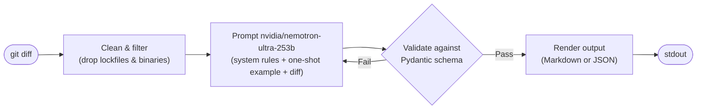

# DiffNotes

DiffNotes is a command-line tool that reads a `git diff` and produces a structured, validated pull request description using a large language model.

Writing a good PR description after a coding session is friction most developers skip. DiffNotes removes that friction: run one command, get a complete description with a title, change type, summary, a prioritised bullet list of changes, a breaking-change flag, risk areas, and testing notes ready to paste into GitHub or GitLab.

The output is not a summary paragraph generated by naively asking a model to "describe this diff." Every field is defined in a Pydantic schema that is sent to the model as a strict JSON schema. The model is constrained to produce output that matches the schema exactly. If it does not, the validation error is fed back into the conversation and the model is asked to fix it up to three attempts before the tool exits with an error.

The model used is **nvidia/nemotron-ultra-253b** via [OpenRouter](https://openrouter.ai), accessed through the OpenAI-compatible API. The tool is wired to OpenRouter rather than a direct provider so that the underlying model can be swapped without changing any application code.

---

## In action

<table>
<tr>
<td></td>
<td></td>
</tr>
</table>

---

## How it works



The diff is cleaned first lockfiles and binary files are stripped before the model sees anything. The prompt includes a system instruction, a one-shot example, and the diff wrapped in XML tags. The model responds with a JSON object. Pydantic validates it. If validation fails, the exact error is appended to the conversation and the model retries.

---

## Output fields

| Field                     | Description                                                       |
| ------------------------- | ----------------------------------------------------------------- |
| `title`                   | Imperative-mood title, max 72 characters, no trailing period      |
| `change_type`             | One of: `feature`, `bugfix`, `refactor`, `docs`, `test`, `chore`  |
| `summary`                 | One or two sentences describing what the diff does                |
| `changes`                 | Ordered bullet list of concrete changes (max 10)                  |
| `breaking_change`         | `true` only if existing consumers could break                     |
| `breaking_change_details` | Required when `breaking_change` is `true`, null otherwise         |
| `risk_areas`              | Parts of the codebase that are risky to touch; empty list if none |
| `testing_notes`           | Test changes visible in the diff, or a fixed message if none      |

---

## Project structure

```
src/prgen/
  cli.py          Entry point   argument parsing and error-to-exit-code mapping
  diff.py         Run git diff, filter lockfiles and binaries
  prompts.py      System prompt, one-shot example, message builder
  schema.py       Pydantic model for the PR description (also the JSON schema sent to the model)
  generate.py     Retry loop   calls provider, validates, feeds errors back
  render.py       Render a validated PRDescription to Markdown
  errors.py       Exception hierarchy with retryable and exit_code attributes
  providers/
    openrouter.py OpenAI-SDK client pointed at OpenRouter
tests/
  test_schema.py  Unit tests for Pydantic validators and cross-field rules
  test_render.py  Smoke test for Markdown rendering
  test_provider.py  Manual integration script (requires a real API key)
```

---

## Requirements

- Python 3.10 or later
- Git installed and on `PATH`
- An [OpenRouter](https://openrouter.ai) API key

---

## Local setup

**1. Clone the repository**

```bash
git clone https://github.com/MagMc007/DiffNotes.git
cd DiffNotes
```

**2. Create and activate a virtual environment**

```bash
python -m venv .venv

# Linux / macOS
source .venv/bin/activate

# Windows (PowerShell)
.venv\Scripts\Activate.ps1
```

**3. Install the package and its dependencies**

```bash
pip install -e .
```

Dependencies installed automatically:

| Package         | Purpose                                                   |
| --------------- | --------------------------------------------------------- |
| `openai>=1.0`   | OpenAI-compatible HTTP client used to call OpenRouter     |
| `pydantic>=2.0` | Schema definition, JSON validation, and field constraints |
| `python-dotenv` | Load `OPENROUTER_API_KEY` from a `.env` file              |

**4. Add your API key**

Create a `.env` file in the project root:

```
OPENROUTER_API_KEY=your-key-here
```

Get a key at [openrouter.ai/keys](https://openrouter.ai/keys). A free account is enough to use free-tier models.

---

## Usage

**Describe staged changes**

```bash
diffnotes --staged
```

**Describe all unstaged working-tree changes**

```bash
diffnotes
```

**Diff against a base branch**

```bash
diffnotes --base main
```

**Output as JSON instead of Markdown**

```bash
diffnotes --staged --format json
```

---

## Running tests

```bash
pytest tests/test_schema.py tests/test_render.py
```

`test_provider.py` is an integration script that makes a real API call. Run it manually when you need to verify end-to-end behavior:

```bash
python tests/test_provider.py
```

---

## Exit codes

| Code | Meaning                                                  |
| ---- | -------------------------------------------------------- |
| `0`  | Success                                                  |
| `1`  | Provider or generation error                             |
| `2`  | Bad input (empty diff, git not found, invalid arguments) |
